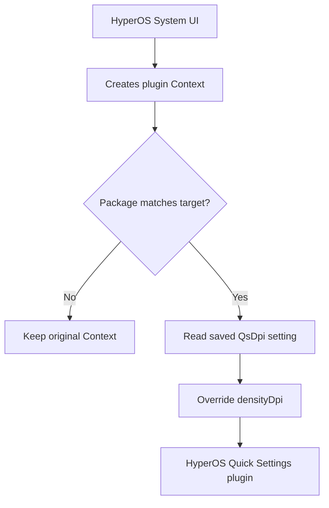

<div align="center">


# QsDpi

### Give HyperOS Quick Settings its own density.

A lightweight LSPosed module that applies an independent DPI value to the HyperOS Control Center / Quick Settings plugin — without changing the rest of the system's display density.

<p>
  
  
  
  
  
</p>

</div>

---

## ✨ Features

- **Independent Quick Settings DPI** — tune the HyperOS Control Center separately from the system-wide display density.
- **Live value preview** — choose a panel density from **400 to 600 DPI** in the settings UI.
- **Save or save + restart** — save your setting, or request a System UI restart to apply it immediately.
- **Target package setting** — defaults to `miui.systemui.plugin`.
- **Optional verbose logs** — help inspect which package contexts are created.
- **Minimal runtime behavior** — only `densityDpi` is overridden; other configuration values continue to follow the system.

> [!NOTE]
> The 400–600 range is the range exposed by the current settings slider. The hook itself accepts values from 120–1000 DPI, and `0` disables the override.

## 🧭 How it works

HyperOS loads its Control Center UI from a separate plugin package. QsDpi hooks the context-creation methods inside System UI and wraps the matching plugin context with a configuration that changes only `densityDpi`.



This means the override affects resources resolved through the plugin context. It does **not** change the device's global display DPI.

## 📱 Settings

The app provides a central DPI value with a slider and two quick actions:

- **Save** — stores the selected DPI.
- **Save + Restart** — stores the selected DPI and attempts to restart System UI (root access required).

The current repository package includes the neon QsDpi launcher artwork above. Add real device screenshots to `assets/` and link them here when available; no mock screenshots are presented as actual app captures.

## 🔧 Requirements

- Android **12 or newer** (minimum SDK 31).
- A compatible **HyperOS** build with the Control Center plugin package.
- LSPosed with module support.
- Root access is needed for the in-app System UI restart action. You can instead restart System UI or reboot manually.
- Enable the module and include **System UI** (`com.android.systemui`) in its LSPosed scope.

## 🚀 Installation

1. Build the APK using the instructions below, or download a build artifact from your own GitHub Actions run.
2. Install the APK on your device.
3. Open **LSPosed** and enable **QsDpi**.
4. In the module scope, select **System UI** (`com.android.systemui`).
5. Open QsDpi and choose a panel DPI.
6. Tap **Save + Restart**, or restart System UI / reboot manually.
7. Pull down the Control Center to check the result.

The default target package is:

```text
miui.systemui.plugin
```

If your HyperOS build uses a different package, update **Target package** in the app.

## 🛠️ Build from source

### Android Studio

1. Open the project directory in Android Studio.
2. Use **JDK 17**.
3. Sync Gradle, then select **Build → Build APK(s)**.

### Command line

```bash
gradle assembleDebug
```

The debug APK is generated at:

```text
app/build/outputs/apk/debug/app-debug.apk
```

The repository's GitHub Actions workflow also builds the debug APK on every push and on manual workflow dispatch.

### Xposed API dependency fallback

The project uses:

```kotlin
compileOnly("de.robv.android.xposed:api:82")
```

If `api.xposed.info` is unavailable, download `api-82.jar`, place it in `app/libs/`, and replace that dependency with:

```kotlin
compileOnly(files("libs/api-82.jar"))
```

## 🧪 Troubleshooting

### The panel does not change

- Confirm QsDpi is enabled in LSPosed.
- Confirm **System UI** (`com.android.systemui`) is selected in the module scope.
- Confirm the target package is correct (default: `miui.systemui.plugin`).
- Save the setting and restart System UI or reboot.

### Check LSPosed logs

Open **LSPosed → Logs → Modules** and search for `QsDpi`.

Example messages:

```text
[QsDpi] hooks installed in com.android.systemui
[QsDpi] miui.systemui.plugin: density 440 -> 480
```

If the density override is not logged, enable **Verbose logging**, restart System UI, and inspect the package-context messages.

### Save works, but restart does not

The in-app restart action invokes `su`, so it requires working root access. Restart System UI manually or reboot if root is unavailable.

## ⚠️ Known limitations

- The override affects everything created using the target plugin context, not necessarily only Quick Settings tiles.
- Text sizes are density-scaled too, so text may become smaller or larger along with the layout.
- HyperOS internal class and class-loader details may vary by build. The original project notes that HyperOS `3.0.305` has not been tested.
- Use a value that remains comfortable and readable on your device.

## 📂 Project structure

```text
QsDpi/
├── .github/workflows/build.yml
├── app/
│   └── src/main/
│       ├── assets/xposed_init
│       ├── java/com/example/qsdpi/
│       │   ├── MainHook.kt
│       │   ├── Prefs.kt
│       │   └── SettingsActivity.kt
│       └── res/
├── build.gradle.kts
├── settings.gradle.kts
└── README.md
```

## 🤝 Contributing

Issues, device compatibility reports, and pull requests are welcome. When reporting a problem, include:

- Your device model and HyperOS version.
- The target plugin package name.
- The selected DPI value.
- Relevant `QsDpi` entries from LSPosed logs.

---

<div align="center">

**QsDpi** · Fine-tune the panel, not the whole system.

</div>
